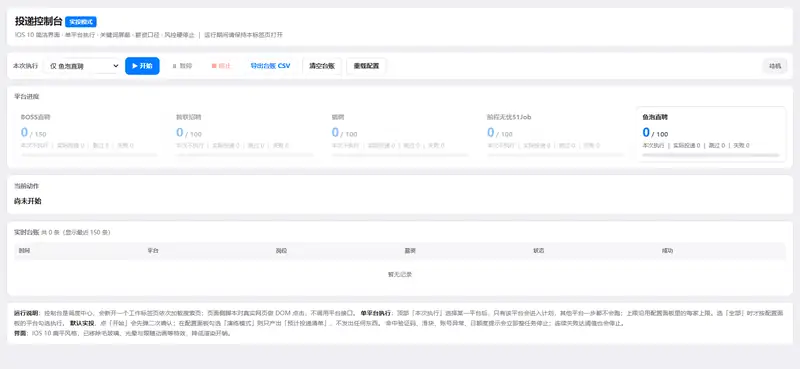
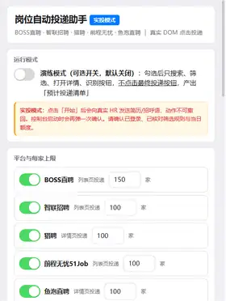
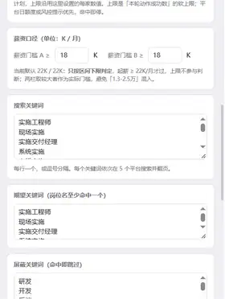
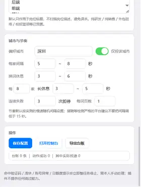

# 岗位自动投递助手 · Job Apply Assistant

**五个平台，一个投递工作台。岗位扫描、条件筛选、页面操作与执行台账，全部集中在一处。**

支持 BOSS直聘 · 智联招聘 · 猎聘 · 前程无忧 51Job · 鱼泡直聘

[**下载完整 ZIP**](https://github.com/ZhangLiang-cn/job-apply-assistant/archive/refs/heads/main.zip) · [功能](#功能) · [截图](#截图) · [使用说明](#使用说明) · [配置项](#配置项说明) · [AIBOT 系列](#aibot--workbuddy-系列) · [社区](#社区与官网)

---

> [!IMPORTANT]
> **演练模式**只扫描、筛选、打开详情并识别按钮，**不点击最终投递按钮**；切换到**实投模式**后，会触发招聘网站原生沟通或投递流程，可能向 HR 发送简历、招呼语并形成**无法撤回的记录**。使用前请本人确认运行模式、岗位与简历内容。

> [!TIP]
> **不会打包也没关系。** 本仓库直接提供完整成品 ZIP，下载解压后即可在 Chrome / Edge 加载，**无需自行编译、无需重新打包**。[点此下载 ↓](https://github.com/ZhangLiang-cn/job-apply-assistant/archive/refs/heads/main.zip)

## 简介

面向求职者的浏览器扩展（Manifest V3）：在一个控制台里管理 BOSS直聘、智联招聘、猎聘、前程无忧 51Job、鱼泡直聘五个平台。按关键词扫描岗位，按薪资、期望词、屏蔽词和城市筛选，记录执行台账并支持导出 CSV。是否实投由使用者自行决定；命中验证码、滑块、账号异常或额度提示时任务会自动停止，不提供任何绕过能力。

## 截图

|                                                          |                                                            |
| :------------------------------------------------------: | :--------------------------------------------------------: |
|  |  |
|                           投递控制台                           |                    运行模式与平台上限                            |
|  |  |
|                       薪资门槛与关键词                           |                       城市与执行节奏                            |

> 以上均为真实软件界面截图。截图中的关键词、薪资、城市与执行间隔属于某次配置示例，不是固定默认值。

## 支持平台

| 平台 | 页面适配方式 |
| :--- | :--- |
| BOSS直聘 | 搜索列表页投递 |
| 智联招聘 | 搜索列表页投递 |
| 猎聘 | 岗位详情页投递 |
| 前程无忧 51Job | 搜索列表页投递（UI 翻页） |
| 鱼泡直聘 | 岗位详情页投递（未识别投递控件时跳过） |

> [!WARNING]
> 招聘网站会调整页面结构、按钮文案和交互策略。适配效果以实际运行结果为准，不保证平台改版后仍可直接使用。

## 功能

- **多平台扫描** —— 按搜索关键词进入各平台搜索页，读取当前页面可见的岗位卡片信息。
- **多条件筛选** —— 薪资起点（K/月）、期望关键词、屏蔽关键词、偏好城市，减少无关岗位进入执行队列。
- **跨平台去重** —— 结合平台、岗位、薪资、城市与公司信息记录已处理岗位，避免重复操作。
- **单平台执行** —— 可指定本轮只运行某一个平台，也可按配置运行多个平台，避免误跑。
- **过程控制** —— 运行中可暂停、继续或手动停止；连续失败达到设定次数后自动停止。
- **节奏配置** —— 每家间隔、换词休息、每 N 家长休息、每关键词页数均可调。
- **安全停止** —— 命中验证码、滑块、人机验证、账号异常或额度提示时停止任务，不尝试绕过。
- **执行台账** —— 展示平台、岗位、薪资、状态与成功情况，支持导出 CSV 核对。

## 运行模式

| 模式 | 行为 | 适用场景 |
| :--- | :--- | :--- |
| **演练模式**（默认） | 扫描、筛选、打开详情、识别按钮，**不点击最终投递按钮**，产出「预计投递清单」 | 首次使用、验证筛选规则、检查岗位相关性 |
| **实投模式** | 点击招聘网站页面的原生沟通 / 投递控件，形成真实投递记录 | 本人已核对岗位、简历与上限后手动开启 |

> [!CAUTION]
> 实投模式的动作**不可撤回**。启动前请确认：已登录本人账号、简历内容正确、筛选规则符合预期、本轮额度合理。

## 下载与安装

### 方式一：直接下载完整 ZIP（推荐）

1. 点击下载：[job-apply-assistant-main.zip](https://github.com/ZhangLiang-cn/job-apply-assistant/archive/refs/heads/main.zip)
2. 右键 ZIP →「全部解压」，打开解压后的 `job-apply-assistant-main` 文件夹，确认能看到 `manifest.json`。
3. Chrome 地址栏输入 `chrome://extensions`；Edge 输入 `edge://extensions`。
4. 打开右上角「**开发者模式**」。
5. 点击「**加载已解压的扩展程序**」，选择含 `manifest.json` 的 `job-apply-assistant-main` 文件夹。
6. 安装后可将扩展固定到浏览器工具栏，点击图标开始配置。

### 方式二：从仓库下载

打开 [项目主页](https://github.com/ZhangLiang-cn/job-apply-assistant) → 绿色 `Code` 按钮 → `Download ZIP`，再按上面步骤解压加载。

> **说明**：提供的是**可加载的扩展源码 ZIP**，不是 Chrome Web Store 的 CRX。首次加载需开启浏览器开发者模式；**不需要用户自己编译或重新打包**。

## 使用说明

1. **登录平台** —— 在浏览器中由本人登录需要使用的招聘网站。插件使用浏览器现有登录状态，不要求提供账号密码。
2. **打开配置** —— 点击工具栏插件图标，检查本轮启用的平台和每个平台执行上限。
3. **设置搜索关键词** —— 每行一个关键词，也可用逗号分隔；系统按关键词逐个平台搜索。
4. **设置岗位筛选** —— 配置期望关键词、屏蔽关键词、薪资门槛和偏好城市。期望词用于岗位标题命中判断，屏蔽词命中后跳过。
5. **检查执行节奏** —— 设置每家间隔、换词休息、长休息、连续失败停止次数和每关键词页数。请遵守招聘网站规则，不要设置过短间隔进行高频操作。
6. **打开控制台** —— 选择本次执行的平台。单平台运行不会自动执行其他平台；选择「全部」时按配置中已启用的平台生成计划。
7. **先演练** —— 演练模式会扫描、筛选、打开详情并识别按钮，但不点击最终投递按钮。先检查预计投递清单和岗位相关性。
8. **决定是否实投** —— 只有本人确认岗位、简历内容、平台范围和本轮上限后，才切换实投模式并启动。
9. **检查台账** —— 运行期间可暂停、继续或停止。结束后检查成功、跳过和失败原因，按需导出 CSV。

## 配置项说明

| 配置 | 用途 |
| :--- | :--- |
| 本次执行平台 | 控制台选择单个平台或全部平台；单平台运行不会自动执行其他平台 |
| 平台与每家上限 | 启用 / 停用平台，并设置本轮每个平台的执行数量上限 |
| 薪资门槛 A / B | 单位 K/月；按薪资区间起薪下限判断，上限不参与筛选；两项取较大值作为实际门槛 |
| 搜索关键词 | 每行一个或逗号分隔；按关键词逐个平台搜索 |
| 期望关键词 | 岗位标题至少命中一个期望词才进入后续筛选 |
| 屏蔽关键词 | 岗位标题命中屏蔽词后直接跳过 |
| 偏好城市 | 可开启「仅投该城市」；依赖页面对岗位城市的识别结果 |
| 每家间隔 | 两个岗位之间的操作等待范围，单位秒 |
| 换词休息 | 切换搜索关键词时的等待范围 |
| 长休息 | 每处理指定数量岗位后，进行阶段性休息 |
| 连续失败 | 连续失败达到设定次数后停止任务 |
| 每词页数 | 每个搜索关键词的扫描页数；不同平台支持情况可能不同 |
| 实时台账 | 展示执行记录，并可导出 CSV |

## 安全与隐私

- 页面操作基于招聘网站当前页面中的**可见 DOM 元素**和浏览器点击事件，不直接调用招聘平台业务 API，不伪造网络请求或篡改页面字段。
- 插件**不读取、不保存**招聘平台账号密码，使用浏览器现有登录状态。
- 配置、任务状态、去重记录和台账保存在浏览器扩展**本地存储**中。
- 命中验证码、滑块、人机验证、账号异常或额度提示时任务会停止；**不提供验证码识别、滑块拖动、指纹伪装或请求伪装功能**。

## AIBOT · WorkBuddy 系列

本项目属于 **AIBOT 研发与探索** 的工具实践。更多 WorkBuddy 系列插件：

| 插件 | 用途 |
| :--- | :--- |
| **AIBOT 文档工厂** | 面向 PDF、Word、Excel 等资料的内容识别、字段提取、模板填充与文档处理 |
| **公文助手专业版** | 面向正式公文起草、改写与规范化处理 |
| **全球股票研究** | 面向全球市场、上市公司、行业线索与研究观点的结构化分析 |

## 社区与官网

| 渠道 | 链接 |
| :--- | :--- |
| X（推特） | 搜索 **AIBOT｜研发与探索 @J4pFj** — [打开搜索](https://x.com/search?q=AIBOT%7C%E7%A0%94%E5%8F%91%E4%B8%8E%E6%8E%A2%E7%B4%A2%20%40J4pFj) |
| 官网 1 | [www.sosoos.com](https://www.sosoos.com) |
| 官网 2 | [www.aibotcn.com](https://www.aibotcn.com) |
| 官网 3 | [www.ailnc.com](https://www.ailnc.com) |
| 源码仓库 | [github.com/ZhangLiang-cn/job-apply-assistant](https://github.com/ZhangLiang-cn/job-apply-assistant) |
| 问题反馈 | [Issues](https://github.com/ZhangLiang-cn/job-apply-assistant/issues) |

## 许可与免责

本插件仅通过招聘网站页面中的可见控件模拟用户点击，不直接调用招聘平台业务接口。但当选择**实投模式**并点击平台原生沟通 / 投递按钮时，网站仍会按其正常业务流程提交简历、招呼语等信息，并可能形成**真实且无法撤回的投递记录**。使用者应自行确认岗位、简历内容、个人信息披露范围及平台规则，并对由此产生的账号、隐私和投递后果负责。

批量或自动化操作可能受到招聘平台服务条款限制，也可能引发限流、功能限制或账号处置。本项目与 BOSS直聘、智联招聘、猎聘、前程无忧、鱼泡直聘及其关联公司**无隶属、授权或背书关系**。平台页面结构、按钮文案和规则可能变化，部分适配功能可能失效；本项目不保证持续可用，**不提供验证码、滑块或平台风控绕过能力**。请勿用于虚假申请、骚扰或其他违反平台规则的行为。

当前仓库未附加开源许可证。公开可见不等于自动授予复制、修改、再发布或商用权限；正式开源前应明确选择许可证。

---

**AIBOT · 研发与探索** — 把 AI 能力做成真正可用的工具

[下载 ZIP](https://github.com/ZhangLiang-cn/job-apply-assistant/archive/refs/heads/main.zip) · [GitHub](https://github.com/ZhangLiang-cn/job-apply-assistant) · [社区账号](https://x.com/search?q=AIBOT%7C%E7%A0%94%E5%8F%91%E4%B8%8E%E6%8E%A2%E7%B4%A2%20%40J4pFj)

